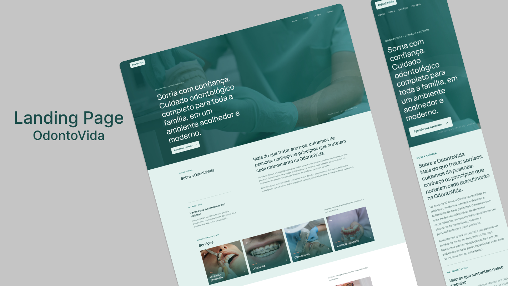

# OdontoVida — Landing Page

Landing page institucional fictícia para uma clínica odontológica, desenvolvida com React, JavaScript e CSS. O projeto busca apresentar a clínica, seus serviços e sua equipe por meio de uma interface moderna, responsiva e focada na experiência do usuário.

## Preview



## Funcionalidades

- Layout responsivo para desktop, tablet e dispositivos móveis.
- Apresentação institucional, serviços e equipe.
- Formulário de contato (em desenvolvimento).
- Integração com Firebase (pendente).

## Tecnologias

- HTML5
- CSS3
- JavaScript
- React
- Vite
- Firebase (integração planejada)

## Processo de desenvolvimento

**1. Wireframe e estruturação**

Utilizei referências do Dribbble para desenvolver o wireframe no Figma, adaptando a estrutura para desktop, tablet e dispositivos móveis.

[Visualizar wireframe no Figma](https://www.figma.com/design/vHDmjOXghrUlc9gHvpiWQT/OdontoVida?node-id=1-2)

**2. Design da interface**

Desenvolvi o design final no Doop Design, trabalhando a identidade visual, organização dos elementos e experiência de navegação.

[Visualizar design no Doop](https://doop.design/c/3fwmXP9CVW)

[Visualizar mockup no Figma](https://www.figma.com/design/M2uVqLSxoSIna12EWXRS3W/Sem-título?node-id=0-1)

**3. Implementação**

Desenvolvimento da interface utilizando React, JavaScript e CSS, com foco em responsividade e organização dos componentes.

## Como executar

```bash
git clone https://github.com/mPaulatech/odontovida-site.git
cd odontovida-site
npm install
npm run dev
```

## Status do projeto

- [x] Wireframe e planejamento.
- [x] Design da interface.
- [x] Implementação do layout.
- [x] Responsividade.
- [ ] Implementação do formulário de contato.
- [ ] Integração com Firebase.

---

Desenvolvido por **Maria Paula Silva** para fins de estudo e portfólio.
